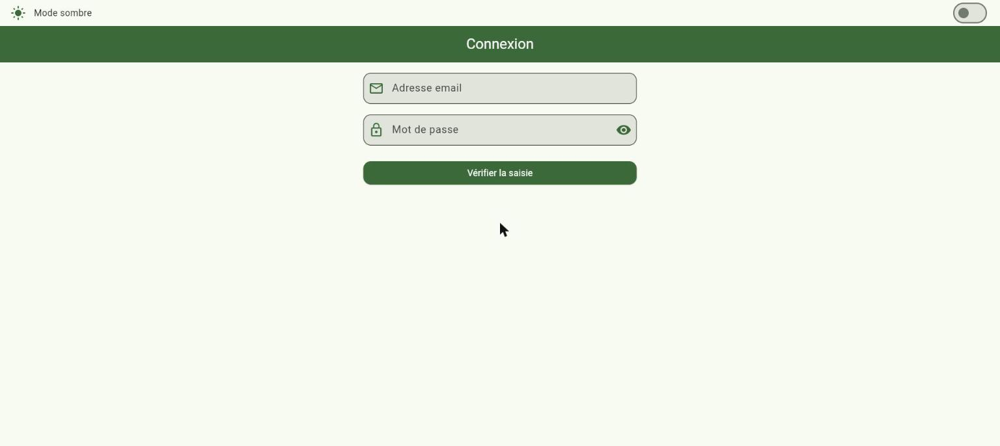
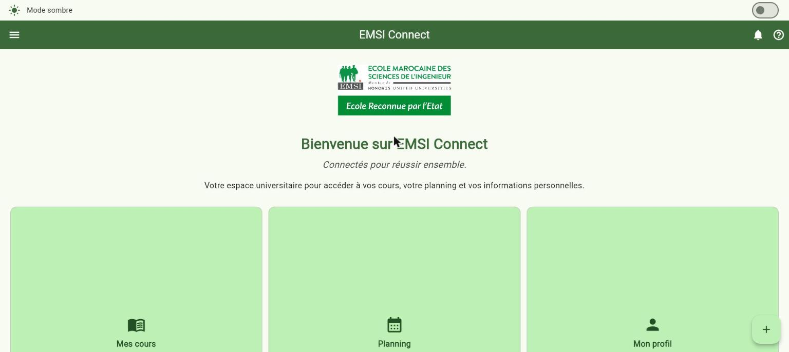

# EMSI Connect

EMSI Connect est une application Flutter conçue pour centraliser les principaux services de la vie étudiante dans une interface simple et adaptée aux petits écrans.

L’application propose un parcours complet : connexion et inscription avec validation locale, puis un tableau de bord donnant accès aux cours, au planning, au profil, aux paramètres et à la page « à propos ».

## Captures d'écran

<p align="center">
  
  
</p>

## Fonctionnalités

- Connexion et inscription avec validation locale des champs (email, mot de passe, téléphone).
- Tableau de bord responsive organisé en quatre rubriques, avec menu latéral (Drawer) de navigation.
- Présentation des cours, du planning, du profil et des tâches.
- Écran de profil avec les informations de l’étudiant, nom modifiable et carte étudiant responsive.
- Page de détails étudiant et page « à propos ».
- Page de paramètres (notifications, mode compact).
- Bascule de thème clair/sombre (couleur de base verte, ColorScheme Material 3).
- Interface Material Design compatible avec les écrans mobiles et le Web.

## Technologies

- [Flutter](https://flutter.dev/)
- [Dart](https://dart.dev/)
- Material Design

## Structure du projet

```text
assets/
  images/
lib/
  main.dart
  screens/
    about_page.dart
    courses_page.dart
    home_page.dart
    login_page.dart
    profile_page.dart
    register_page.dart
    settings_page.dart
    student_details_page.dart
  utils/
    validators.dart
test/
  widget_test.dart
web/
pubspec.yaml
```

`main.dart` initialise l’application et démarre sur l’écran de connexion. Les écrans sont isolés dans `lib/screens`, et les validateurs de formulaire dans `lib/utils`.

## Installation

Prérequis : une installation fonctionnelle de Flutter sur le canal stable.

```bash
git clone https://github.com/Wvssim/emsi-connect-flutter.git
cd emsi-connect-flutter
flutter pub get
flutter run
```

Pour lancer directement la version Web :

```bash
flutter run -d chrome
```

## Vérification

```bash
flutter analyze
flutter test
```

## Évolution prévue

- Données étudiantes dynamiques.
- Gestion du planning et des tâches.
- Authentification et persistance réelles (actuellement simulées localement).
